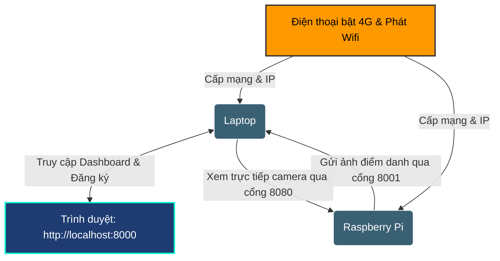

# 📶 HƯỚNG DẪN CẤU HÌNH KHI DÙNG 4G PHÁT WIFI / ĐỔI SANG MẠNG MỚI

Khi bạn mang Laptop và Raspberry Pi đi báo cáo (Demo), lên trường học, hoặc sang quán cafe, **việc sử dụng Wifi công cộng rất dễ thất bại** do các mạng này thường có trang đăng nhập (Captive Portal) hoặc tính năng **AP Isolation (Cách ly thiết bị)** chặn không cho Laptop và Pi giao tiếp với nhau.

> [!IMPORTANT]
> **PHƯƠNG PHÁP KHUYÊN DÙNG 100% CỦA CHUYÊN GIA:** Sử dụng **4G trên điện thoại để phát Wifi (Mobile Hotspot)** cho cả Laptop và Raspberry Pi kết nối vào. Đây là phương pháp **nhanh nhất, ổn định nhất và 100% thành công** khi đi demo ở bất kỳ đâu!

Tài liệu này hướng dẫn chi tiết cách dùng 4G phát Wifi và các bước cập nhật IP hệ thống.

---

## 🗺️ SƠ ĐỒ KẾT NỐI QUA 4G HOTSPOT



---

## 👑 PHẦN I: TUYỆT CHIÊU "GIẢ LẬP WIFI" (KHÔNG CẦN CÀI ĐẶT LẠI WIFI CHO PI)

Nếu bạn đã từng cấu hình Pi kết nối vào một mạng Wifi nào đó ở nhà (ví dụ tên Wifi là `NhaCuaToi` mật khẩu `88888888`), bạn có thể dùng mẹo này để **Pi tự động kết nối ngay lập tức** mà không cần cắm màn hình hay cấu hình dòng lệnh mạng phức tạp trên Pi!

### Bước 1: Thiết lập Điểm phát sóng (Hotspot) trên Điện thoại
Bạn cấu hình tên và mật khẩu của điểm phát 4G trên điện thoại **giống y hệt** mạng Wifi mà Pi đã từng kết nối trước đây:

* 📱 **Đối với iPhone (iOS):**
  1. Vào **Cài đặt** -> **Cài đặt chung** -> **Giới thiệu** -> Sửa dòng **Tên** thành tên Wifi cũ (Ví dụ: `NhaCuaToi`).
  2. Quay lại **Điểm phát sóng cá nhân** -> Nhập mật khẩu Wifi cũ (Ví dụ: `88888888`).
  3. Bật **Điểm phát sóng cá nhân**. Nhớ bật tùy chọn **Tối đa hóa khả năng tương thích** (nếu có).

* 📱 **Đối với Android (Samsung, Xiaomi, Oppo,...):**
  1. Vào **Cài đặt** -> **Điểm phát sóng di động** (hoặc Chia sẻ kết nối).
  2. Chọn **Thiết lập điểm phát sóng**.
  3. Sửa **Tên mạng (SSID)** thành tên Wifi cũ (Ví dụ: `NhaCuaToi`) và **Mật khẩu** giống hệt mật khẩu cũ (Ví dụ: `88888888`).
  4. Lưu lại và Bật điểm phát sóng.

### Bước 2: Khởi động thiết bị
* Bật nguồn Raspberry Pi và kết nối Laptop vào mạng Wifi điện thoại vừa phát.
* Vì tên và mật khẩu giống hệt mạng cũ, **cả Raspberry Pi và Laptop sẽ tự động kết nối vào điện thoại của bạn** trong vòng 30 giây! Bạn không cần thực hiện thêm bước cấu hình mạng nào cho Pi cả.

---

## 🟢 PHẦN II: NẾU BẠN PHÁT WIFI 4G VỚI TÊN & MẬT KHẨU MỚI BẤT KỲ

Nếu bạn muốn tạo một mạng Wifi 4G mới hoàn toàn trên điện thoại (ví dụ tên Wifi là `DemoApp` mật khẩu `99999999`), hãy làm theo các bước sau để kết nối Pi vào mạng mới:

### 1. Trên Laptop (Windows)
* Kết nối Laptop vào Wifi mới phát từ điện thoại.

### 2. Trên Raspberry Pi (Cách kết nối vào Wifi mới phát)
Vì Pi không có màn hình, bạn hãy dùng **dây cáp mạng LAN** để cấu hình tạm thời:
1. Cắm cáp mạng LAN kết nối trực tiếp từ cổng mạng của Raspberry Pi sang cổng LAN của Laptop.
2. Đợi 1 phút, trên Laptop mở Terminal (CMD hoặc PowerShell) và gõ lệnh để SSH vào Pi:
   ```bash
   ssh pi@raspberrypi.local
   ```
   *(Nhập mật khẩu của Pi, mặc định là `raspberry`).*
3. Sau khi vào được Terminal của Pi, gõ lệnh cấu hình hệ thống:
   ```bash
   sudo raspi-config
   ```
4. Chọn **System Options** -> Chọn **Wireless LAN** -> Nhập **Tên Wifi di động mới** và **Mật khẩu** bạn vừa tạo trên điện thoại.
5. Chọn **Finish** để hoàn tất. Lúc này Pi sẽ ngắt kết nối dây LAN và tự động nhảy sang kết nối Wifi 4G của điện thoại. Bạn có thể rút dây LAN ra.

---

## 🟡 PHẦN III: XÁC ĐỊNH ĐỊA CHỈ IP MỚI KHI DÙNG 4G

Khi kết nối qua mạng 4G điện thoại, dải IP sẽ chuyển sang dạng đặc thù của điện thoại (thường là `192.168.43.X` trên Android hoặc `172.20.10.X` trên iPhone). Hãy lấy IP mới:

### 1. Lấy IP mới của Laptop (Server)
1. Trên Laptop, nhấn `Windows + R`, gõ `cmd` và ấn `Enter`.
2. Gõ lệnh: `ipconfig`
3. Tìm phần **Wireless LAN adapter Wi-Fi**, ghi lại số **IPv4 Address** (Ví dụ: `192.168.43.102` hoặc `172.20.10.2`).

### 2. Lấy IP mới của Raspberry Pi (Client)
1. Trên Laptop, mở CMD/PowerShell và gõ:
   ```bash
   ssh pi@raspberrypi.local
   ```
2. Gõ lệnh để lấy IP:
   ```bash
   hostname -I
   ```
3. Ghi lại số IP hiện ra (Ví dụ: `192.168.43.15` hoặc `172.20.10.5`).

> [!TIP]
> **MẸO CỰC HAY:** Thay vì phải đi tìm IP của Pi mỗi lần kết nối, hệ thống của bạn có hỗ trợ tên miền cục bộ **`raspberrypi.local`**. Bạn có thể dùng tên này thay thế hoàn toàn cho địa chỉ IP của Pi khi cấu hình OBS hay Dashboard!

---

## 🔵 PHẦN IV: CẬP NHẬT CẤU HÌNH HỆ THỐNG

Sau khi đã có các thông số IP mới, hãy cập nhật vào code của bạn:

### 1. Trên Raspberry Pi (Cập nhật IP của Laptop)
1. Trong cửa sổ SSH của Pi, mở file cấu hình bằng lệnh:
   ```bash
   nano ~/FaceTrack_IOT_EDGE_COMPUTING-http/detect_and_crop/main.py
   ```
2. Sửa dòng **SERVER_URL** (dòng 12) bằng **IP mới của Laptop**:
   ```python
   # Ví dụ khi kết nối mạng 4G Android:
   SERVER_URL = "http://192.168.43.102:8001/api/attendance/process"
   ```
3. Nhấn `Ctrl + O` -> `Enter` để lưu -> `Ctrl + X` để thoát.

### 2. Trên Dashboard Laptop (Cập nhật IP của Pi)
1. Khởi động hệ thống bằng cách chạy file `BAT-DAU-HE-THONG.bat` trên Laptop.
2. Mở trình duyệt web truy cập `http://localhost:8000`.
3. Vào Tab **Sinh viên** -> Click chọn **Chụp từ Camera Pi**.
4. Ở ô **Địa chỉ IP Raspberry Pi**, bạn có thể nhập thẳng:
   ```text
   raspberrypi.local
   ```
   *(Hoặc nếu mạng không tự nhận diện được tên miền, hãy nhập IP số của Pi ở phần trên như `192.168.43.15`).*
5. Nhấn **Kết nối** để camera hiển thị mượt mà.

### 3. Trên phần mềm OBS Studio
* Click đúp vào Source camera Pi của bạn trong OBS, cập nhật đường dẫn URL mới:
  * Link camera sạch: `http://raspberrypi.local:8080/raw` (hoặc `http://<IP_PI_MỚI>:8080/raw`)
  * Link camera có khung vẽ: `http://raspberrypi.local:8080/` (hoặc `http://<IP_PI_MỚI>:8080/`)

---

## 🛠️ XỬ LÝ SỰ CỐ NHANH KHI DÙNG 4G

* **Laptop ping được Pi nhưng Pi không gửi được ảnh về Laptop (Lỗi kết nối Server):**
  * Nguyên nhân lớn nhất là **Windows Defender Firewall** trên Laptop chặn cổng `8001` từ các mạng bên ngoài.
  * **Cách xử lý:** Mở menu Windows, tìm kiếm **Windows Defender Firewall** -> chọn **Turn Windows Defender Firewall on or off** -> Tạm thời tắt Firewall ở phần **Private network settings** và **Public network settings** trong lúc chạy demo. Nhớ bật lại sau khi xong!
* **Mạng 4G yếu hoặc chập chờn:**
  * Đặt điện thoại ở nơi thoáng gió, gần cửa sổ để bắt sóng 4G tốt nhất. Tránh đặt điện thoại trong túi quần hoặc dưới gầm bàn kim loại khi đang phát sóng.

---
*Tài liệu được cập nhật mới nhất cho nhu cầu chạy thử nghiệm di động. Chúc bạn báo cáo đồ án thành công rực rỡ!*
